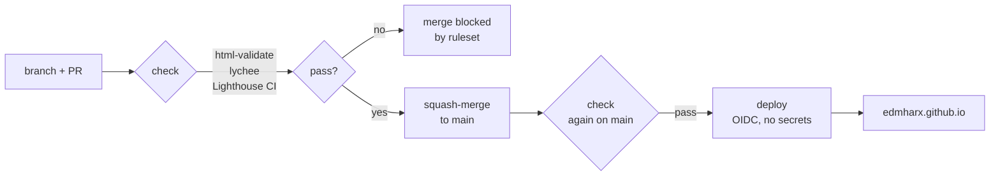

# edmharx.github.io

[](https://github.com/edmharx/edmharx.github.io/actions/workflows/pages.yml)

My portfolio site, live at https://edmharx.github.io/.

Changes reach the site only through a pull request. GitHub Actions checks the HTML, every link
and the Lighthouse scores, and once those pass it deploys to GitHub Pages using OIDC, so the repo
stores no deploy secret.

[PR #1](https://github.com/edmharx/edmharx.github.io/pull/1) tests this. It added a broken image
link, the check failed, and GitHub refused to merge it until a second commit fixed the path.


## How a change ships



| Job | When it runs | What it does | Time |
|---|---|---|---|
| `check` | every pull request and every push to `main` | [html-validate](https://html-validate.org/) checks the HTML against the spec, [lychee](https://github.com/lycheeverse/lychee) checks every link and image path, and [Lighthouse CI](https://github.com/GoogleChrome/lighthouse-ci) loads the page three times and scores the median run | 1 to 1.5 min |
| `deploy` | after `check` passes on `main` | copies only the site files into `_site/`, packages them with `upload-pages-artifact` and publishes them with `deploy-pages` | about 20 s |

## Rules on `main`

A ruleset blocks direct pushes, force-pushes and deleting the branch. Every change needs a pull
request, and the `check` job has to pass on a branch that is up to date with `main`. The required
check is tied to the GitHub Actions app, so nobody can mark it green through the API.

Lighthouse fails the build if accessibility drops below 95, or best practices or SEO below 90.
A performance score below 85 only prints a warning (the lessons below explain why).

The workflow token is read-only. Only the `deploy` job gets `pages: write` and `id-token: write`.

Every action is pinned to a full commit SHA with its version in a comment, and the tools are
pinned to exact versions: `html-validate@11.18.0`, lychee `v0.24.2` and `@lhci/cli@0.16.0`.

Pages publishes only `index.html`, `css/`, `js/` and `assets/`. The README, the config files and
the workflow stay in the repo.

## What broke and what I learned

### The strict HTML preset was mostly noise

`html-validate:recommended` reported 14 errors. Nearly all of them were style rules, such as the
lowercase doctype and the `role="list"` I add on purpose so Safari keeps list semantics. The
`standard` preset found one real bug: an `aria-label` on a `<div>` with no role, which screen
readers ignore. I fixed it with `role="group"` and kept the `standard` preset, because I want the
check to fail on bugs and leave style choices to me.

### LinkedIn answers bots with status 999

The link checker flagged my own LinkedIn profile. LinkedIn returns 999 to automated requests, so
`.lycheeignore` skips it, with the reason written in the file.

### Lighthouse performance scores move between runs

On a shared GitHub runner, one commit scored 86, 89 and 91 within a single job. A hard limit on
that number would fail at random, and I would start ignoring red builds, so performance only
warns. Accessibility, best practices and SEO scored the same in every run (97, 96 and 100), so
those block the merge.

### A failing check blocked nothing until the ruleset existed

Before I added the ruleset, a red pull request could still be merged. Making `check` a required
status on `main` is what stops it.

### My first merge attempt failed with a 502

`gh pr merge` returned `HTTP 502 Bad Gateway`. That came from GitHub's API and had nothing to do
with my rules. The retry showed the ruleset's real message:
`the base branch policy prohibits the merge`.

## Run the checks locally

These are the same versions CI uses.

```fish
npx --yes html-validate@11.18.0 index.html
podman run --rm -v $PWD:/input:ro,Z -w /input docker.io/lycheeverse/lychee:0.24.2 --no-progress --root-dir /input index.html
set -x CHROME_PATH /path/to/chrome-or-chromium   # any Chromium-based browser
npx --yes @lhci/cli@0.16.0 autorun                # reports land in .lighthouseci/ (git-ignored)
```

To preview the site, run `python3 -m http.server 8000 --bind 127.0.0.1` and open
http://127.0.0.1:8000.

## Files

```
index.html                    the whole page
css/site.css                  tokens, reset and every working part
css/aurora.css                the layout (portrait hero, full-width chapters)
js/site.js                    pipeline replay, Break the build, log tabs, charts, contact form
assets/                       photos, renders, logos, video; sources + licences in assets/credits.json
.github/workflows/pages.yml   the check + deploy pipeline
.htmlvalidate.json            HTML rules (standard preset)
.lycheeignore                 links the checker skips, with reasons
lighthouserc.json             Lighthouse CI runs and thresholds
docs/screenshot.png           README screenshot (not deployed)
```

The site is plain HTML, CSS and JavaScript, with no build step and no framework.

## Changing the site

- To change colours, edit the tokens at the top of `css/site.css` (`--bg`, `--ink`, `--accent`,
  `--frost`, …). The two colour fields are in `css/aurora.css`: `.chapter-field` (frost) and
  `.chapter-contact` (pine).
- To change the photo, replace `assets/img/me.jpg` (4:5 portrait, about 960 × 1200).
- To add a project, copy one `<article class="s-proj c-wide"> … </article>` block in the Projects
  section of `index.html`, then change its name, tags, text and `<figure>`.
- To add a tool, copy one `<li>` in a `.tools` list. Logos come from https://simpleicons.org:
  download the SVG into `assets/logos/` and add `fill="#d8dee9"` to its `<svg>` tag.
- Each day in the learning log is an `<ol class="day">` with a matching tab button.
  `git --no-pager log --format='%ad|%s' --date=format-local:'%m-%d %H:%M'` in `~/homelab` prints
  the real commit times and messages.

## Credits

Tool logos are from Simple Icons (CC0; the brands are their owners' trademarks). The PUP seal is
public domain, from Wikimedia Commons. The hero background is "NOIRLab HQ Server Racks" by
NOIRLab/NSF/AURA/T. Slovinský, CC BY 4.0, softened and darkened. All of them are listed in
`assets/credits.json` and in the page footer.
